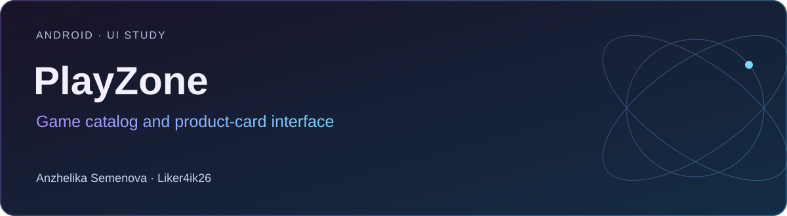

# PlayZone

**Android · UI study** · Kotlin · Jetpack Compose · Material 3

Учебный интерфейс игрового каталога: категории, карточки игр, рейтинги, отзывы и кнопки установки и запуска.

[Портфолио автора](https://portfolio.semenova-anzhelika.online/) · [Профиль GitHub](https://github.com/Liker4ik26) · [Исходники](https://github.com/Liker4ik26/PlayZone/tree/develop)

> Исходники интерфейса находятся в develop, галерея этапов — в основной ветке main. Реальная установка или запуск сторонних игр здесь не заявляются.

## Как выглядит проект

| Интерфейс | Сценарии |
| :---: | :---: |
| <br/>Экран 1 | <br/>Экран 2 |
| <br/>Экран 3 | <br/>Экран 4 |

[Все изображения проекта](docs/GALLERY.md)

## Что в проекте

- Категории и карточки игр с изображениями.
- Компоненты рейтинга и пользовательских отзывов.
- Кнопки установки и запуска в интерфейсе.
- Галерея последовательных этапов работы.

[APK и материалы из исходного README](https://drive.google.com/drive/folders/1ATA7o0O0BRQjXgYH7y4MA_1aDnkQwWKA?usp=sharing)

## Технологии

| Направление | Реализация |
| :--- | :--- |
| Стек | Kotlin · Jetpack Compose · Material 3 |
| Формат | Android · UI study |
| Окружение | Android Studio; JDK, совместимый с Gradle; compileSdk 34; minSdk 24 |

## Как запустить

Требования: Android Studio; JDK, совместимый с Gradle; compileSdk 34; minSdk 24.

```bash
git clone --branch develop https://github.com/Liker4ik26/PlayZone.git
cd PlayZone
```

Откройте корень репозитория в Android Studio, выполните Gradle Sync и выберите Android-эмулятор или устройство. Для сборки из терминала:

```bash
bash gradlew :app:assembleDebug
```

## English overview

**PlayZone — Game catalog and product-card interface.**

Android · UI study. Stack: Kotlin · Jetpack Compose · Material 3. The full application source is in the `develop` branch. [Explore my professional portfolio](https://portfolio.semenova-anzhelika.online/).

---

**Автор — Анжелика Семёнова · [Liker4ik26](https://github.com/Liker4ik26)**

[Сайт](https://portfolio.semenova-anzhelika.online/) · [Telegram](https://t.me/Liker4ik50) · [Почта](mailto:pr110oat18@gmail.com)
